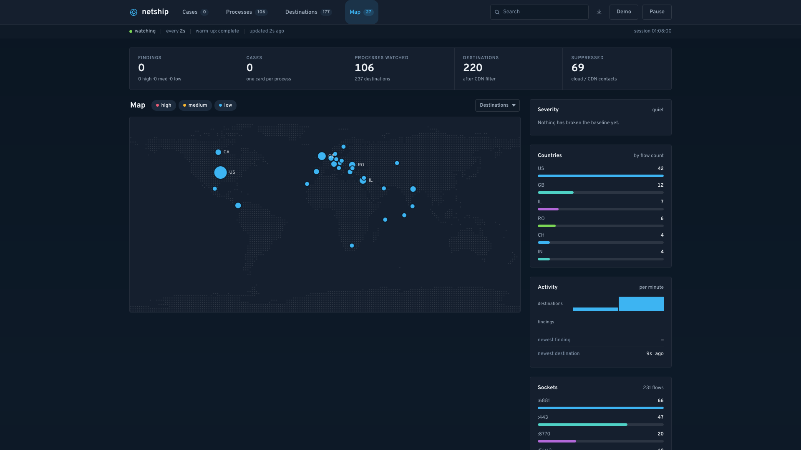

<div align="center">

# netship

**A process-level egress monitor that stays quiet until something changes.**


</div>

A network monitor that shows you every connection is a log you stop reading. netship keeps one baseline per executable: every remote endpoint that binary has ever reached. When a binary goes somewhere new, you get a case. The rest of the time it does nothing.

It is one Go binary that reads the socket table and the process table. Nothing to install alongside it, and it never needs root.

## How it works

- It polls the socket table every 2 seconds and throws most of it away: its own sockets, sockets with no owning process, loopback, private addresses, and the teardown states.
- Each socket is attributed to its executable and process start time, so a browser restarted forty times is one subject, not forty.
- Every remote is looked up over plain DNS (Team Cymru). If the ASN belongs to a cloud or CDN provider the contact is dropped before anything is stored, and the dashboard counts how much went that way, so you can see the filter working.
- Whatever survives is compared against `baseline.json`.
- Only the difference becomes a finding.

The numbers this came from: one minute of ordinary desktop use produced 356 rows, 70 of them sockets that had already closed, 69 with no owning process, and zero findings.

## Quickstart

```bash
# Build (needs Go 1.26.3 or newer)
go build -o netship.bin .
./netship.bin
```

```
netship - what is new on this machine's network edge

  dashboard  http://127.0.0.1:8787
  config     ~/.config/netship/config.json
  baseline   ~/.local/share/netship (0 binaries)
  poll       every 2s, silent for the first 5m
```

Open the URL and press **Start**. The first 5 minutes are silent on purpose, that is the baseline filling up. Quiet after that is also normal, and an empty case list is the healthy state on a laptop.

> [!NOTE]
> **Demo** seeds a throwaway store with three fake cases on documentation addresses (RFC 5737), so you can see what a finding looks like without waiting for one on your own machine. The watcher does not run in demo mode.

## The Map

The map view plots one dot per contacted country, sized by flow count. The land is a bundled 2 degree mask (180 by 90, bit packed) and the positions come from a table of 244 country centroids, both shipped as plain JS, so it renders with the network off.



## Config

`~/.config/netship/config.json`, written with these defaults on first run:

```json
{
  "listen": "127.0.0.1:8787",
  "data_dir": "~/.local/share/netship",
  "interval": "2s",
  "learning": "5m",
  "enrich": true
}
```

- `listen`: bound to loopback on purpose. This dashboard lists your process names, command lines, usernames and destinations, and it has no authentication.
- `interval`: how often the socket table is read. Under a second it mostly re-reads the same sockets.
- `learning`: how long to stay silent at startup while the baseline fills.
- `enrich`: `false` turns off the DNS lookups. Without it, nothing can be classified as a CDN, so the tool still works but reports far less.

Missing keys keep their defaults, so a partial file is fine. Deleting the file re-creates it.

## Reset

Forget everything it has learned:

```bash
rm ~/.local/share/netship/baseline.json
```

## Findings

| kind | severity | fires when |
| --- | --- | --- |
| `SUSPICIOUS_CMD` | high | the command line looks like download and execute: `curl ... \| sh`, `base64 -d`, `/dev/tcp/`, `nc -e`, PowerShell `iex` |
| `FIRST_NETWORK` | medium, high from a bad origin | an executable with no baseline makes its first outbound connection |
| `NEW_DESTINATION` | low, medium from a bad origin | a known binary talks to a non-cloud endpoint it has never used |
| `RISKY_ORIGIN` | medium | something from `/tmp`, `Downloads` or `node_modules`, or a binary edited in the last day, goes out |
| `NEW_LISTENER` | low | a new binary binds a port reachable off loopback, or any port from a bad origin |
| `FANOUT` | medium | one process reaches 8 or more new destinations inside a minute |

Severity stacks the facts about one process: an untrusted origin plus a first ever connection is high, the same connection from `/usr/bin` is low.

## The Bits It Can't Do

- **Short-lived processes.** At 2s polling, a `curl` that lives 300ms is usually missed, and if it exits before attribution there is nothing to name.
- **Volume.** The socket table has no byte counters, so there is no exfiltration detection.
- **Names and payloads.** It sees the IP and the port, because that is all the socket table holds. The payload is never read.
- **Other users' processes.** Without root it sees yours.
- **Cold start.** Anything already running before the first scan is normal by definition. Reset the baseline if you think that happened.
- **Resistance.** Anything that wants to kill it can.

## Known issues

- The map draws every country on one canvas. A few hundred destinations is fine, a few thousand is not.
- A very large baseline takes a moment to load before the dashboard has anything to show.
- The demo store is seeded once per process and thrown away on exit, so the charts always start from the same place.
- On a machine with many short-lived processes, the baseline file grows one key per executable until the 90 day TTL catches up.
- Linux only in practice. On macOS gopsutil builds the socket table from `lsof` and leaves the process id at 0, so every connection is dropped as unattributable and nothing is ever reported. Windows compiles and has a real pid source, but it has not been run.
