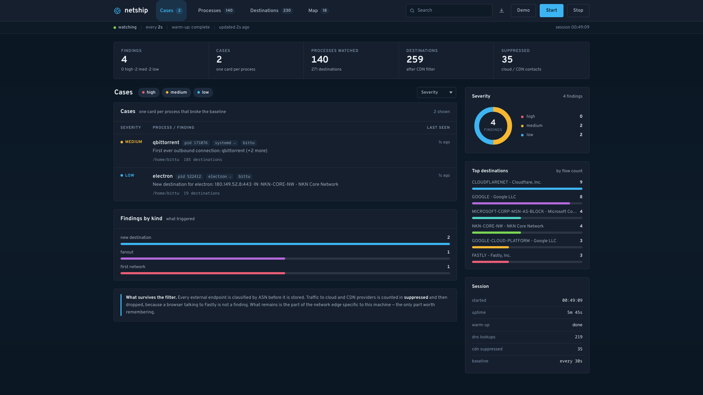

<div align="center">

# netship

**Remembers where each program on the machine has connected, so anything new stands out.**



</div>

Every program on this machine leaves a trail of places it has connected to. netship keeps that trail, and when a program reaches somewhere new you get a case with the process, the destination, who owns it, and what stood out about it.

It is one Go binary that reads the socket table and the process table. Nothing to install alongside it, and it never needs root.

## How it works

- It polls the socket table every 2 seconds and throws most of it away: its own sockets, sockets with no owning process, loopback, private addresses, and the teardown states.
- Each socket is attributed to its executable and start time. For the baseline that means a browser restarted forty times is one subject, not forty, though the live case list still shows one card per running instance.
- Every remote is looked up over plain DNS (Team Cymru). If the ASN belongs to a cloud or CDN provider the contact is dropped before anything is stored, and the dashboard counts how much went that way, so you can see the filter working.
- Whatever survives is compared against `baseline.json`.
- Only the difference becomes a finding.

The numbers this came from: one minute of ordinary desktop use produced 356 rows, 70 of them sockets that had already closed and 69 with no owning process.

## Quickstart

```bash
# Build (needs Go 1.26.3 or newer)
go build -o netship.bin .
./netship.bin
```

`./build.sh` cross compiles linux, macOS and Windows into `dist/` if you want the other platforms, and tagging `v*` makes CI publish those as a release.

```
netship - what is new on this machine's network edge

  dashboard  http://127.0.0.1:8787
  config     ~/.config/netship/config.json
  baseline   ~/.local/share/netship (0 binaries)
  poll       every 2s, baseline for the first 5m
```

The watcher starts with the binary, so by the time you open the URL it is already running. **Stop** and **Start** control it from there. The first 5 minutes go into the baseline; after that, new destinations appear as cases.

> [!NOTE]
> **Demo** seeds a throwaway store with three fake cases on documentation addresses (RFC 5737), so you can see what a finding looks like without waiting for one on your own machine. The watcher does not run in demo mode.

## The Map

The map view plots one dot per contacted country, sized by flow count. The land is a bundled 2 degree mask (180 by 90, bit packed) and the positions come from a table of 244 country centroids, both shipped as plain JS, so it renders with the network off.


## Config

`~/.config/netship/config.json`, written with these defaults on first run:

```json
{
  "listen": "127.0.0.1:8787",
  "data_dir": "~/.local/share/netship",
  "interval": "2s",
  "learning": "5m",
  "enrich": true
}
```

- `listen`: bound to loopback on purpose. This dashboard lists your process names, command lines, usernames and destinations, and it has no authentication.
- `interval`: how often the socket table is read. Under a second it mostly re-reads the same sockets.
- `learning`: how long the baseline takes to fill at startup.
- `enrich`: `false` turns off the DNS lookups. Every remote is then unknown, so only a process with a bad origin can raise anything, and the CDN filter stops running.

Missing keys keep their defaults, so a partial file is fine. Deleting the file re-creates it.

## Reset

Forget everything it has learned:

```bash
rm ~/.local/share/netship/baseline.json
```

## Findings

| kind | severity | fires when |
| --- | --- | --- |
| `SUSPICIOUS_CMD` | high | the command line looks like download and execute: `curl ... \| sh`, `base64 -d`, `/dev/tcp/`, `nc -e`, PowerShell `iex` |
| `FIRST_NETWORK` | medium, high from a bad origin | an executable with no baseline makes its first outbound connection |
| `NEW_DESTINATION` | low, medium from a bad origin | a known binary talks to a non-cloud endpoint it has never used. Every new remote gets its own finding |
| `RISKY_ORIGIN` | medium | something from `/tmp`, `Downloads` or `node_modules`, or a binary edited in the last day, goes out |
| `NEW_LISTENER` | low, medium from a bad origin | a binary binds a port it has never bound before, off loopback. Unconnected UDP sockets are not counted |
| `FANOUT` | medium | one process reaches 8 or more new destinations inside a minute |

Severity stacks the facts about one process: an untrusted origin plus a first ever connection is high, the same connection from `/usr/bin` is low.

## The Bits It Can't Do

- **Short-lived processes.** At 2s polling, a `curl` that lives 300ms is usually missed, and if it exits before attribution there is nothing to name.
- **Volume.** The socket table has no byte counters, so there is no exfiltration detection.
- **Names and payloads.** It sees the IP and the port, because that is all the socket table holds. The payload is never read.
- **Other users' processes.** Without root it sees yours.
- **Cold start.** Anything already running before the first scan is normal by definition. Reset the baseline if you think that happened.
- **Resistance.** Anything that wants to kill it can.

## Known issues

- The map draws every country on one canvas. A few hundred destinations is fine, a few thousand is not.
- A very large baseline takes a moment to load before the dashboard has anything to show.
- The demo store is seeded once per process and thrown away on exit, so the charts always start from the same place.
- On a machine with many short-lived processes, the baseline file grows one key per executable until the 90 day TTL catches up. The whole file is rewritten every 30s.
- The sha256 in a case is shown, not used. A binary replaced at the same path keeps the old baseline history.
- Findings survive a restart, flows do not. After a restart the case list is the old one until something new happens.
- Tested on Linux. On macOS the socket table comes from `lsof`, because gopsutil hands back pid 0 there and everything looked unattributable; that path is written but has not been run on a real Mac. Windows compiles and has a real pid source, and it has not been run either.
